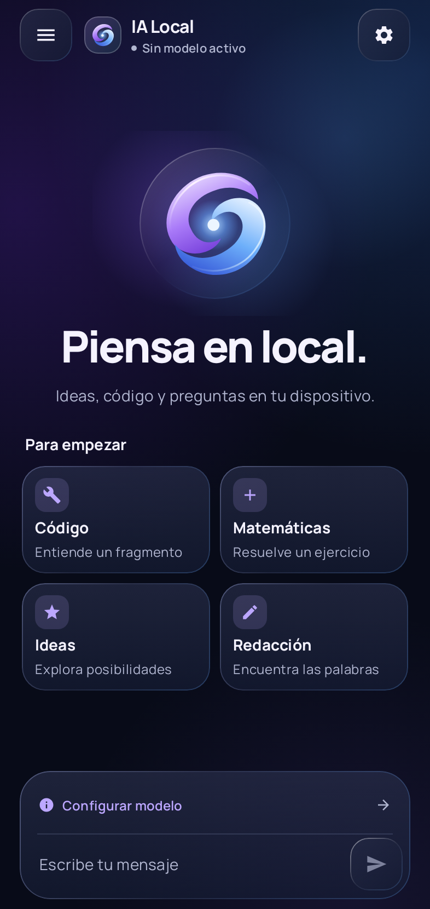
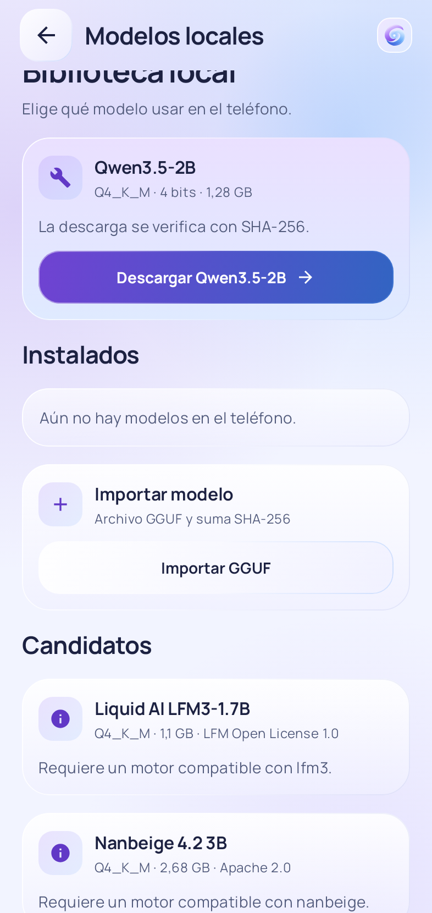

# Rediseño Liquid Glass · 0.3.0

La interfaz usa una combinación de violeta, azul y superficies blancas translúcidas. El símbolo vectorial se comparte entre el encabezado, la bienvenida y el icono adaptativo del lanzador, que también tiene una capa monocroma. El sistema de diseño comparte tipografía Manrope, reflejos biselados y opacidad ajustada al tema. Las superficies de interacción y las burbujas tienen tratamientos distintos para que se reconozcan por su forma y su jerarquía.

- **Chat**. Bienvenida con dos cintas asimétricas alrededor de un núcleo luminoso, sugerencias de entrada, compositor flotante y bloques de código copiables.
- **Historial**. Panel lateral translúcido con búsqueda por título, creación de chat y las opciones existentes de edición y borrado.
- **Ajustes y modelos**. Tarjetas y selectores comunes, temas claro, oscuro y del sistema, control de movimiento y acceso a la biblioteca GGUF.

## Capas y movimiento

El fondo usa iluminación radial. En Android 12 y posteriores con aceleración por hardware, el historial aplica un desenfoque de 7 dp al contenido de la app que queda detrás cuando el panel está abierto y asentado. Durante una respuesta en curso o una transferencia se usa el oscurecimiento. En versiones anteriores el panel mantiene el oscurecimiento, la transparencia y el borde de cristal.

El cajón usa anclajes y gestos de Compose. Durante el desplazamiento, el contenido del fondo se aparta ligeramente y las filas se revelan en secuencia. Los cambios de ruta combinan desplazamiento y disolución con una entrada de 310 ms. Los controles de Ajustes comparten una entrada escalonada de 375 ms. Los selectores, interruptores y filas responden al pulsar. **Reducir animaciones** usa cambios instantáneos y conserva botones y navegación Atrás. El buscador cierra el teclado al pulsar **Buscar**.

## Capturas y pruebas

  
  
  
  

El artefacto **Capturas-Liquid-Glass** de GitHub Actions contiene renders de los composables reales en Android 15 con Robolectric. Las capturas de la conversación usan un registro de prueba marcado como ejemplo. La app instalada muestra el historial de cada usuario.

Las pruebas de Compose recorren la bienvenida, ajustes, temas, biblioteca, búsqueda por título, acción Buscar del teclado, deslizamientos del historial, Atrás y bloques de código. La instalación en el Redmi, el aspecto con distintos tamaños de letra, la suavidad de las animaciones y su coste en batería requieren comprobación en el teléfono.

## Compatibilidad con la instalación anterior

El APK estándar conserva el paquete, la base de datos y el motor JNI. La variante **IA Local · Vista previa** pertenece al mismo proyecto y se instala con un identificador separado para que una firma de prueba diferente no obligue a desinstalar la versión anterior. La vista previa 0.3 usa el sufijo de paquete `.preview.v03` y tiene su propio espacio de historial y configuraciones.

La compilación contiene el motor y la gestión de modelos existentes. El catálogo muestra los [dos candidatos evaluados](candidatos-gguf.md) y la descarga directa aprobada de Qwen. Los pesos siguen fuera del APK.

[Manrope y su licencia SIL OFL 1.1](https://github.com/google/fonts/tree/main/ofl/manrope)
