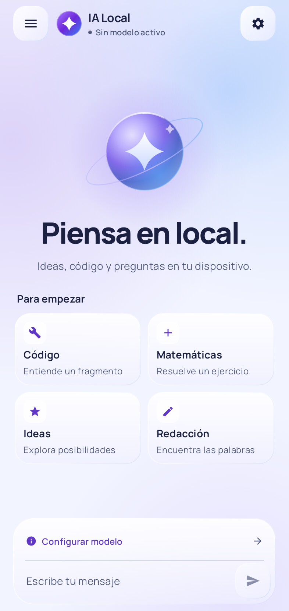
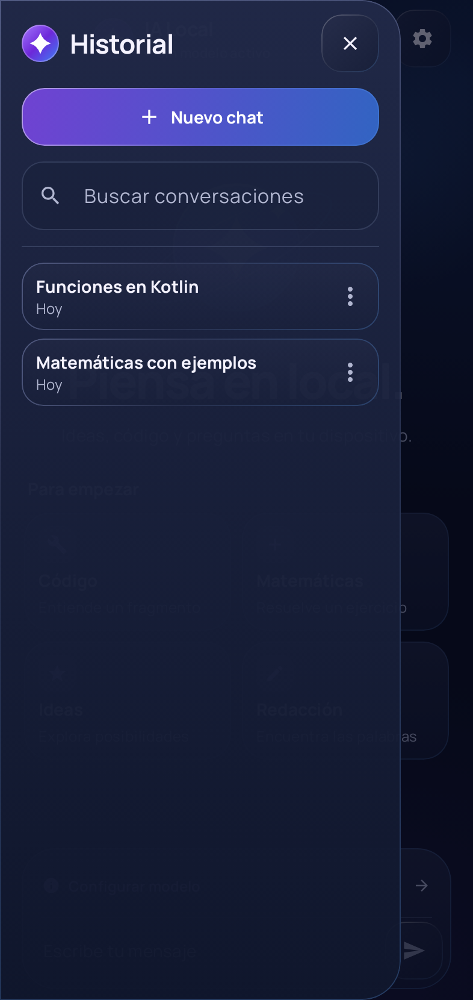

# Rediseño Liquid Glass · 0.2.0

La interfaz usa una combinación de violeta, azul y superficies blancas translúcidas. El sistema de diseño comparte tipografía Manrope, reflejos biselados y opacidad ajustada al tema. Las superficies de interacción y las burbujas tienen tratamientos distintos para que se reconozcan por su forma y su jerarquía.

- **Chat**. Bienvenida con un orbe prismático, sugerencias de entrada, compositor flotante y bloques de código copiables.
- **Historial**. Panel lateral translúcido con búsqueda por título, creación de chat y las opciones existentes de edición y borrado.
- **Ajustes y modelos**. Tarjetas y selectores comunes, temas claro, oscuro y del sistema, control de movimiento y acceso a la biblioteca GGUF.

## Capas y movimiento

El fondo combina iluminación radial de tamaño fijo y una sola capa de desenfoque localizada. En Android 12 y posteriores Compose aplica el efecto de desenfoque de Android. En versiones anteriores el fondo conserva las luces difusas dibujadas con gradientes. Las tarjetas componen ese fondo compartido con un degradado translúcido y un borde iluminado. Se evita capturar y filtrar el contenido que cambia al escribir o durante la generación.

Las transiciones de pantalla, la bienvenida, las inserciones en la lista y la respuesta al pulsar usan animaciones breves. **Reducir animaciones** omite esos efectos y el desplazamiento programado del cajón. La app también respeta los ajustes de animación de Android.

## Capturas y pruebas

  
  
  

El artefacto **Capturas-Liquid-Glass** de GitHub Actions contiene renders de los composables reales en Android 15 con Robolectric. Las capturas de la conversación usan un registro de prueba marcado como ejemplo. La app instalada muestra el historial de cada usuario.

Las pruebas de Compose recorren la bienvenida, ajustes, temas, biblioteca, búsqueda por título y visualización de bloques de código. La instalación en el Redmi, el aspecto con distintos tamaños de letra, la suavidad de las animaciones y su coste en batería requieren comprobación en el teléfono.

## Compatibilidad con la instalación anterior

El APK estándar conserva el paquete, la base de datos y el motor JNI. La variante **IA Local · Vista previa** pertenece al mismo proyecto y se instala con un identificador separado para que una firma de prueba diferente no obligue a desinstalar la versión anterior. La vista previa tiene su propio espacio de historial y configuraciones.

La compilación contiene el motor y la gestión de archivos de modelos que ya existían. Los pesos siguen fuera del APK.

[Manrope y su licencia SIL OFL 1.1](https://github.com/google/fonts/tree/main/ofl/manrope)
